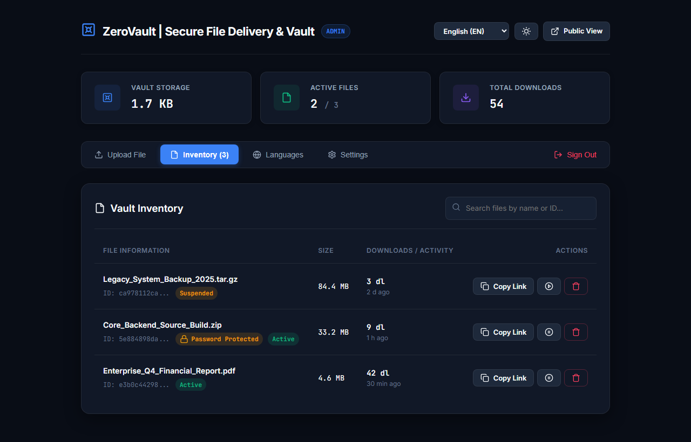
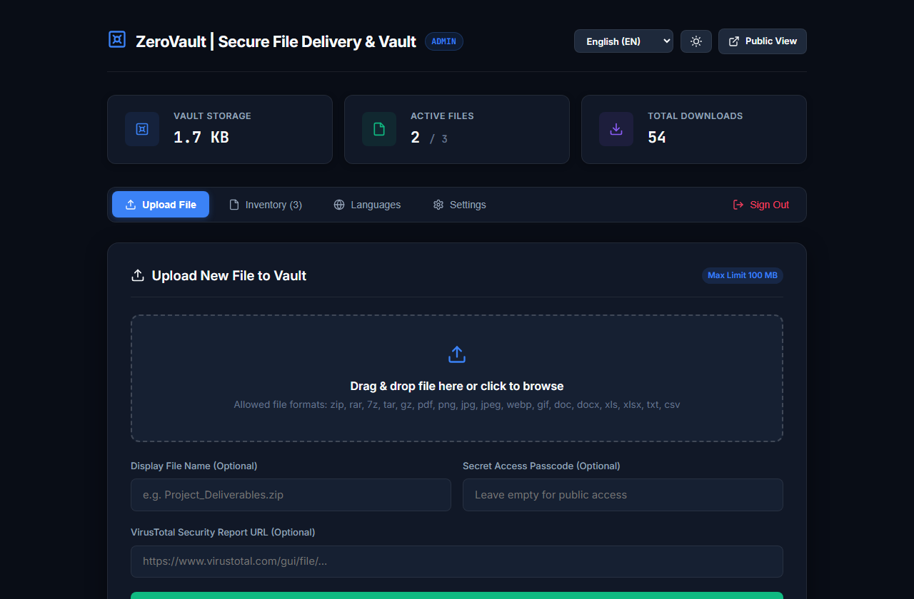
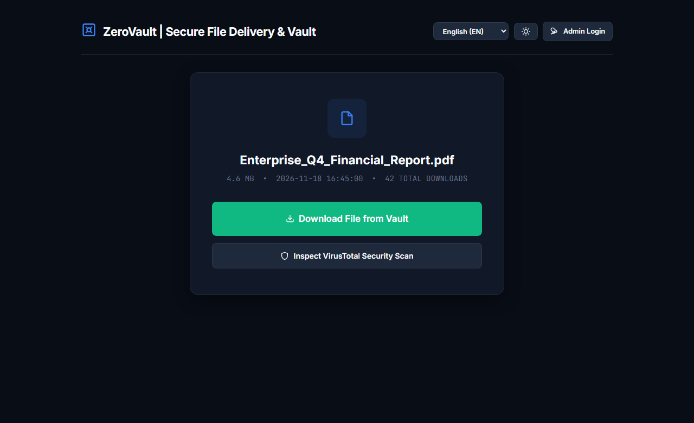
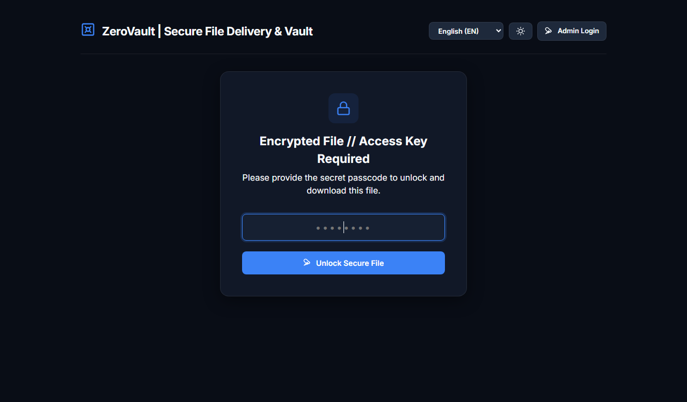
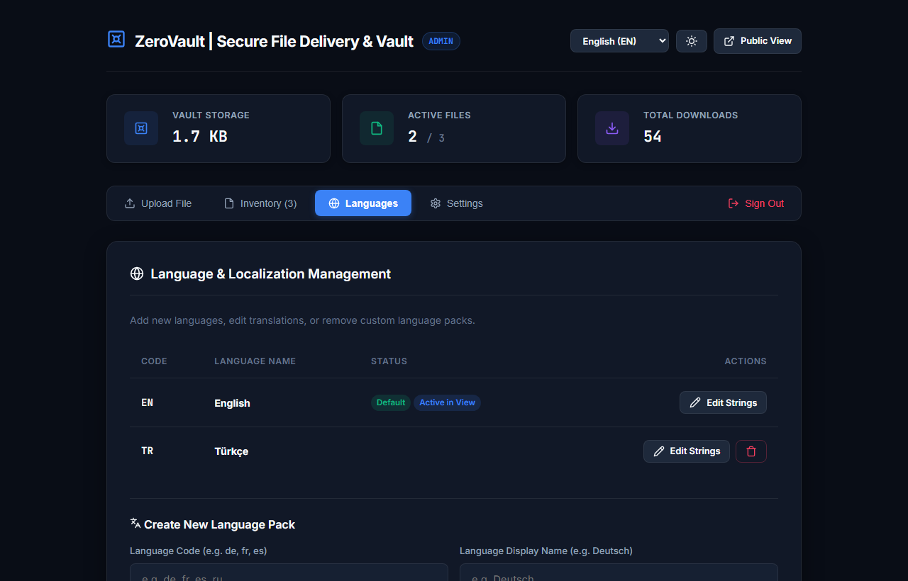
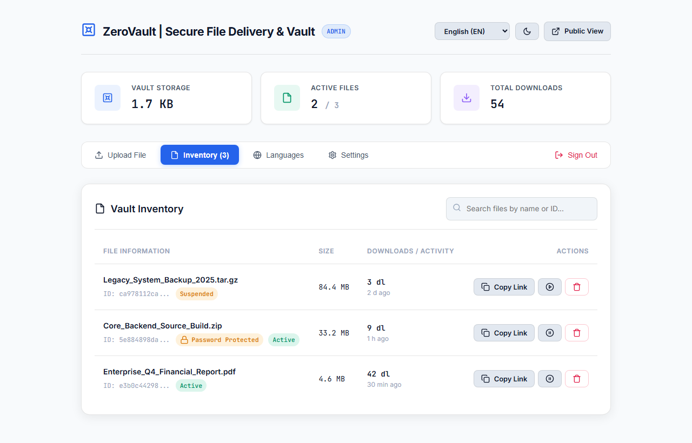

# ZeroVault

> Zero-database, zero-config, self-hosted secure file sharing portal and ephemeral drop vault.

[Türkçe dokümantasyon için README_TR.md dosyasına göz atın.](README_TR.md)

---

ZeroVault is a lightweight, zero-database, self-hosted file delivery portal. It allows you to safely upload, manage, and share files with external clients or recipients using single-file URLs, optional passcode protection, and integrated VirusTotal security verification.

---

## Screenshots

### Admin Dashboard (Inventory & Analytics)


### Drag & Drop File Upload


### Public File Download & Security Scan


### Password-Protected Access Gate


### In-Panel Language & Localization Manager


### Modern Light Theme


---

## Key Features

- **Multi-Language Architecture (i18n):**
  - English (default) and Turkish included out-of-the-box.
  - Dynamic Language Manager: Add any language, customize translations directly in the admin panel, or remove custom language packs without editing code.
  - Quick language selector in the header navigation.
- **Light and Dark Theme:**
  - High-contrast dark theme and clean light theme.
  - Instant toggle with localStorage persistence and zero-flicker loading.
- **Zero-Database (Flat-File):**
  - No MySQL, PostgreSQL, or Redis required.
  - Operates using hardened JSON storage protected by `LOCK_EX` concurrency file locking.
- **Enterprise-Grade Security:**
  - `vault/` storage directory completely blocked from web access and script execution via web server rules.
  - Dynamic file hashing (SHA-256 / random hex) — real file names and server paths are never exposed.
  - IP-based rate limiting (preventing download spam and bandwidth exhaustion).
  - IP-based brute-force defense with automatic timed lockouts.
  - Real MIME-type detection (`finfo`) and banned extension inspection.
  - Strict `realpath` validation preventing path traversal attacks.
  - Full CSRF token protection on all administrative and authentication forms.
- **Smart File Distribution:**
  - Drag-and-drop file upload zone.
  - Optional secret passcode protection for any file.
  - Integrated VirusTotal security scan report linking.
  - Instant one-click link copying with visual feedback.
  - Live inventory search and instant file filtering.
  - Suspend or permanently destroy files at any time.

---

## Server Installation & Setup (CLI)

### System Requirements
- PHP 8.0 or higher
- Web server: Apache (with `mod_rewrite` & `mod_headers`) or Nginx
- Required PHP extensions: `fileinfo`, `session`, `json`

### 1. Clone the Repository via Terminal / SSH / CMD
Navigate to your web root directory (e.g., `/var/www/html` or your domain folder) and clone the repository:

```bash
git clone https://github.com/ozcanbayrii/ZeroVault.git .
```

*(If deploying into a subdirectory, omit the trailing dot and enter the `ZeroVault` folder)*

### 2. Set Permissions
Ensure the web server process has write access to the `vault/` and `languages/` directories:

**Linux / Ubuntu / Debian (Apache or Nginx):**
```bash
sudo chown -R www-data:www-data vault languages
chmod -R 755 vault languages
```

**cPanel / Shared Hosting / Windows Server:**
Set file permissions on the `vault` and `languages` folders to `0755` or `0775`.

### 3. Web Server Configuration

#### Apache
Apache functions automatically using the included `.htaccess` files. Make sure `mod_rewrite` and `mod_headers` are enabled:

```bash
sudo a2enmod rewrite headers
sudo systemctl restart apache2
```

#### Nginx
If running Nginx, add the following configuration block inside your `server { ... }` block:

```nginx
server {
    listen 80;
    server_name your-domain.com;
    root /var/www/html;
    index index.php;

    # Block access to vault and languages directories
    location ~ ^/(vault|languages)/ {
        deny all;
        return 404;
    }

    # Block hidden files (.git, .env, etc.)
    location ~ /\. {
        deny all;
        return 404;
    }

    # URL routing
    location / {
        try_files $uri $uri/ /index.php?$query_string;
    }

    location ~ \.php$ {
        include snippets/fastcgi-php.conf;
        fastcgi_pass unix:/var/run/php/php8.2-fpm.sock;
    }
}
```

### 4. Run Initial Setup
Open your domain in any browser:
```text
https://your-domain.com
```
The **Initial Setup Wizard** will launch automatically. Define your administrator username, password, and preferences to start using ZeroVault.

---

## Project Structure

```text
├── index.php             # Unified monolithic application & router
├── docs/
│   └── screenshots/      # High-resolution UI showcase images
├── languages/            # Localization dictionary files
│   ├── .htaccess         # Direct access protection
│   ├── en.json           # English language pack (Default)
│   └── tr.json           # Turkish language pack
├── vault/                # Secure file storage & configuration (Git-ignored)
│   ├── .htaccess         # Web access denial & execution prevention
│   └── .gitkeep
├── .htaccess             # Security headers & URL rewrite rules
├── .gitignore            # Git exclusion rules protecting private data
├── README.md             # English documentation
└── README_TR.md          # Turkish documentation
```

---

## License
Distributed under the MIT License.
